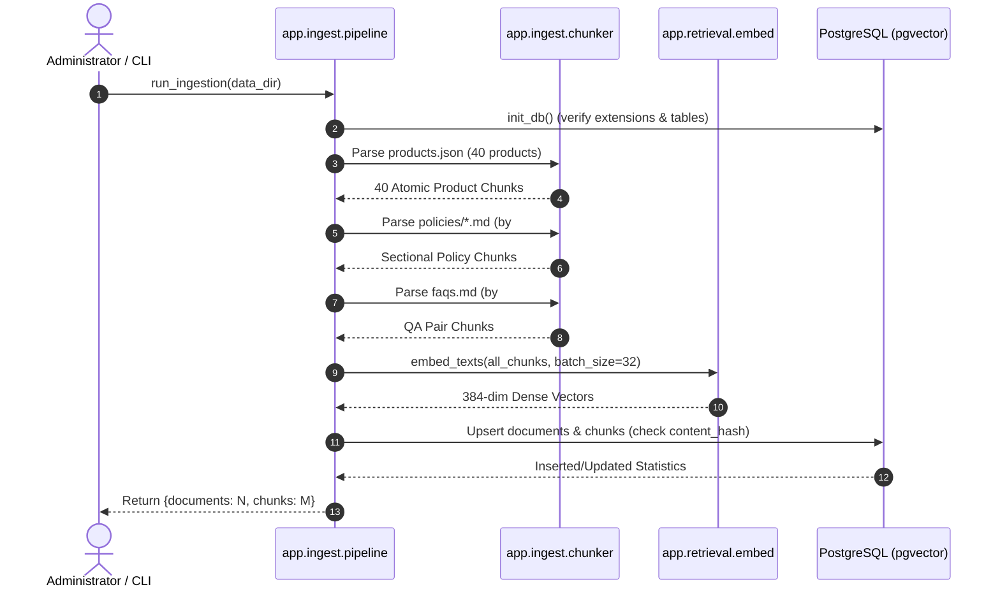
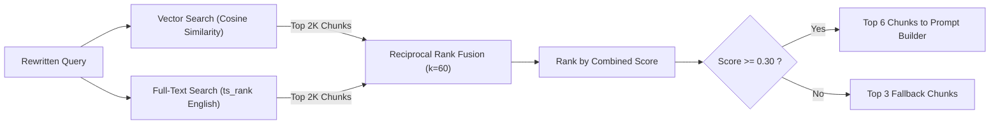
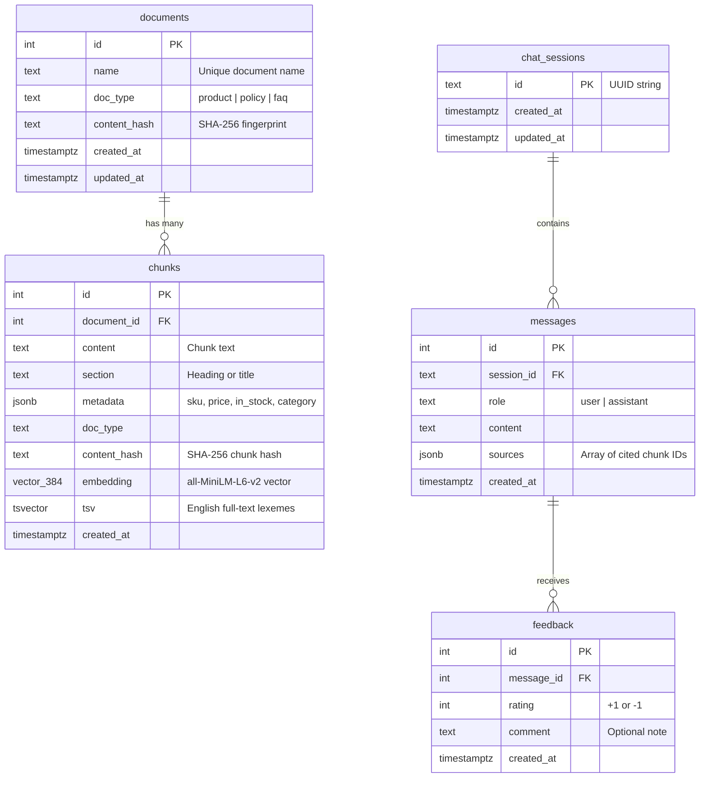

# Software Requirements Specification (SRS)
## Aurelia & Co. — Brand RAG Shopping Assistant

**Document Version:** 1.0.0  
**Status:** Approved / Base Architecture  
**Author:** DeepMind Agentic Engineering & Engineering Team  
**Date:** November 2026  
**System Target:** Retail & E-Commerce Conversational Assistant with Strict Source Grounding  

---

## 1. Introduction

### 1.1 Purpose
This Software Requirements Specification (SRS) document describes the complete functional, non-functional, interface, and data architecture requirements for the **Aurelia & Co. Brand RAG Shopping Assistant**. 

The primary objective of this system is to eliminate hallucination in customer-facing conversational interfaces by implementing a strict **Retrieval-Augmented Generation (RAG)** pipeline. The assistant answers inquiries regarding product specifications, pricing, inventory availability, shipping timetables, return conditions, craftsmanship warranties, and size recommendations **strictly and exclusively** from the verified brand knowledge base, citing primary source chunks for every claim made.

### 1.2 Scope of the System
The system comprises three primary subsystems:
1. **Knowledge Ingestion & Indexing Pipeline**: Structure-aware parsing of structured product inventories (`products.json`), legal/operational policies (`policies/*.md`), and frequently asked questions (`faqs.md`), generating 384-dimensional dense semantic vectors (`all-MiniLM-L6-v2`) and PostgreSQL sparse full-text lexical lexemes (`tsvector`), persisted idempotently using SHA-256 content hashes.
2. **Conversational Hybrid Retrieval & Generation Engine (FastAPI)**: Multi-turn contextual query rewriting, hybrid reciprocal rank fusion (vector similarity + BM25-equivalent full-text ranking), dynamic context construction with numeric citations, and low-latency token streaming over Server-Sent Events (SSE) powered by Google Gemini.
3. **Interactive Client Application (React / Vite)**: Luxury brand aesthetic interface rendering streaming markdown, inline interactive citation tags (`[1]`, `[2]`), a contextual source inspection drawer, responsive product cards, and user feedback mechanisms.

### 1.3 Definitions, Acronyms, and Abbreviations
| Term | Definition |
| :--- | :--- |
| **RAG** | Retrieval-Augmented Generation — combining information retrieval with parametric language generation. |
| **pgvector** | Open-source vector similarity search extension for PostgreSQL. |
| **HNSW** | Hierarchical Navigable Small World — graph-based indexing algorithm for approximate nearest neighbors. |
| **GIN** | Generalized Inverted Index — PostgreSQL index format used for rapid text search queries over `tsvector`. |
| **RRF** | Reciprocal Rank Fusion — algorithm for combining multiple ranked result sets into a single unified ranking. |
| **SSE** | Server-Sent Events — standardized HTTP streaming protocol (W3C) for real-time one-way server-to-client updates. |
| **SKU** | Stock Keeping Unit — unique alphanumeric identifier assigned to each product variant. |
| **TTFT** | Time to First Token — duration in milliseconds between user query dispatch and the arrival of the initial generated token. |
| **SRS** | Software Requirements Specification. |

### 1.4 References
- IEEE Std 830-1998: IEEE Recommended Practice for Software Requirements Specifications.
- PostgreSQL 16 + pgvector documentation.
- Google Gemini API Reference (`google-genai` SDK).
- Sentence-Transformers Documentation (`sentence-transformers/all-MiniLM-L6-v2`).
- W3C Server-Sent Events Specification.

---

## 2. Overall Description

### 2.1 Product Perspective & System Context
The Brand RAG Assistant operates as a dedicated shopping companion integrated into the e-commerce storefront ecosystem. It does not replace transaction checkout systems or live stock inventory feeds in the MVP phase; rather, it serves as the intelligence layer between the brand's static knowledge assets and the purchasing consumer.

```mermaid
flowchart TD
    subgraph ClientLayer["Frontend Client (React + Vite)"]
        UI["Chat Interface (App.jsx)"]
        Hook["useChat Hook (SSE Reader)"]
        Drawer["Source Panel Drawer"]
    end

    subgraph APILayer["Application Backend (FastAPI)"]
        Router["API Router (/chat, /ingest, /sources)"]
        Rewriter["Query Rewriter (Gemini)"]
        Embedder["Embedding Engine (MiniLM-L6-v2)"]
        Hybrid["Hybrid Search & RRF Engine"]
        PromptEngine["Prompt Builder & Guardrails"]
        LLMStream["Gemini Streaming Client"]
    end

    subgraph StorageLayer["Data Tier (PostgreSQL 16 + pgvector)"]
        DocsTable[("documents (hash, doc_type)")]
        ChunksTable[("chunks (vector(384), tsvector)")]
        SessionsTable[("chat_sessions & messages")]
        FeedbackTable[("feedback")]
    end

    subgraph RawData["Raw Knowledge Base"]
        PData["products.json (40 SKUs)"]
        MData["policies/*.md (Returns, Shipping, etc.)"]
        FData["faqs.md (25+ Q&As)"]
    end

    UI -->|HTTP POST /chat| Router
    Hook -->|SSE stream tokens & sources| UI
    Router --> Rewriter
    Rewriter --> Embedder
    Embedder --> Hybrid
    Hybrid -->|Vector <=> HNSW| ChunksTable
    Hybrid -->|FTS @@ GIN| ChunksTable
    Hybrid --> PromptEngine
    PromptEngine --> LLMStream
    LLMStream -->|Yield SSE Events| Hook

    RawData -->|ingest_cli.py / POST /ingest| Router
    Router --> DocsTable
    Router --> ChunksTable
    UI -->|GET /sources/{id}| Drawer
    Drawer --> ChunksTable
```

### 2.2 User Classes and Persona
1. **End-Consumer (Shopper)**:
   - Primary user browsing products, asking sizing questions, comparing luxury materials, checking shipping rates, and verifying return policies.
   - Requires zero friction: fast answers, no login required for chat, visual citation proof, and simple feedback options.
2. **Storefront Administrator / Content Manager**:
   - Manages product line updates, edits markdown policies, and triggers ingestion pipelines via password-protected API endpoints or CLI tools.
3. **Machine Learning / QA Evaluator**:
   - Runs systematic regression benchmarks using the automated evaluation harness (`eval/run_eval.py`) to detect degradation in retrieval hit rate, faithfulness, or refusal behavior.

### 2.3 Operating Environment
- **Host OS**: Cross-platform (Linux, Windows Server, macOS, Docker containers).
- **Backend Runtime**: Python 3.11+.
- **Frontend Runtime**: Node.js 18+ (Vite build engine, modern Chromium / WebKit / Gecko browsers).
- **Database Engine**: PostgreSQL 15 or 16 with `vector` extension enabled (Supabase, Neon, AWS RDS, or local container).
- **External Network Services**: Google AI Studio API endpoint (`https://generativelanguage.googleapis.com`).

---

## 3. External Interface Requirements

### 3.1 User Interfaces (UI/UX)
The user interface follows a modern, luxury brand aesthetic ("Aurelia & Co.") characterized by:
- **Palette**: Deep Navy (`#1B2A4A`), Warm Gold (`#C4956A`), Crisp Cream (`#FAF8F5`), Neutral Gray (`#E8E4DF`).
- **Typography**: Clean humanist sans-serif system stack (`Segoe UI`, `-apple-system`, `Roboto`).
- **Layout Elements**:
  1. **Branded Header**: Displays brand emblem `✦`, title, and operational status.
  2. **Conversation Stream**: Scroll-locked viewport with message bubbles distinguishing user queries (navy, right-aligned) from assistant responses (cream, left-aligned with custom avatar).
  3. **Streaming Indicator**: Pulse cursor during token generation and animated bouncing dots prior to the first chunk arrival.
  4. **Citation Chips**: Interactive inline pills (`[1]`, `[2]`) highlighted in warm gold. Clicking a chip invokes the source inspector.
  5. **Context Inspector Drawer**: A smooth slide-in right drawer displaying the underlying source passage, document category tag, similarity score, and dedicated product attribute cards when referencing inventory items.
  6. **Empty State & Starters**: 6 predefined customer questions ("What materials do you use?", "What's your return policy?", "Do you offer free shipping?", etc.) to facilitate onboarding.
  7. **Feedback Buttons**: Discrete thumbs-up / thumbs-down triggers associated with each completed assistant message.

### 3.2 Software Interfaces & Integration Points
- **PostgreSQL 16 + pgvector**:
  - Connection protocol: Asynchronous binary connection pool via `asyncpg`.
  - Type mappings: `vector(384)` for embeddings, `jsonb` for metadata, `tsvector` for lexical search.
- **Hugging Face / PyTorch**:
  - Sentence-Transformers library running local CPU/GPU inference on `sentence-transformers/all-MiniLM-L6-v2`.
- **Google Gemini API**:
  - `google-genai` SDK v1.0.0+ using model `gemini-2.0-flash` (or `gemini-4-hydrogen`).
  - System prompts and generation configurations: `temperature=0.3`, `max_output_tokens=1024`.

### 3.3 Communications Interfaces
- **HTTP / HTTPS**: Standard REST communication on ports 80/443 (production) or 8000/5173 (development).
- **Server-Sent Events (SSE)**: Standard MIME type `text/event-stream` for unidirectional streaming over persistent HTTP connections.
  - Event types: `token`, `sources`, `done`, `error`.
- **CORS Configuration**: Restrictive origin validation via FastAPI middleware enforcing origins designated in `ALLOWED_ORIGINS`.

---

## 4. System Features & Functional Requirements

### 4.1 Document Ingestion & Chunking Pipeline (REQ-ING)



#### Detailed Requirements:
- **REQ-ING-01 (Product Chunking)**: Products defined in `data/products.json` must be processed as single, indivisible chunks. Under no circumstances may a product's price, SKU, sizing list, care instruction, or material composition be split across separate vectors.
- **REQ-ING-02 (Policy Chunking)**: Policies in `data/policies/*.md` must be split by level-2 markdown headers (`## `). The section heading must be prepended to the chunk text to retain semantic context. Chunks must target 300–500 tokens.
- **REQ-ING-03 (FAQ Chunking)**: FAQs in `data/faqs.md` must be extracted on the `## Q:` delimiter, generating discrete chunks combining the question and answer text.
- **REQ-ING-04 (Content Hashing & Idempotency)**: Every raw document and chunk must be fingerprinted using SHA-256 (`content_hash`). If the hash of an ingested entity matches the hash already recorded in the database, redundant re-embedding and DB writes must be bypassed.
- **REQ-ING-05 (Embedding Standardization)**: All document text must be converted to 384-dimensional unit vectors using `sentence-transformers/all-MiniLM-L6-v2` with embedding normalization enabled (`normalize_embeddings=True`).
- **REQ-ING-06 (Execution Entrypoints)**: Ingestion must be executable via:
  - Command Line: `python -m backend.app.ingest.runner` or `python -m backend.app.ingest.loader`
  - Automated CLI script: `python backend/ingest_cli.py`
  - Authenticated REST Endpoint: `POST /ingest` with `X-Admin-Password` header validation.

---

### 4.2 Multi-Turn Query Rewriting (REQ-RWT)

#### Detailed Requirements:
- **REQ-RWT-01 (Contextual Coreference Resolution)**: When a user query contains conversational pronouns or implicit references to earlier turns (e.g., "What colors does it come in?", "How much was that?"), the query rewriting engine must synthesize recent conversation history (last 4–6 messages) into an autonomous, self-contained search query.
- **REQ-RWT-02 (Standalone Preservation)**: When a query is already self-contained (e.g., "What is your return policy for international orders?"), the rewriter must return the input text without distortion or loss of intent.
- **REQ-RWT-03 (Failure Fallback)**: If the LLM rewrite call encounters a network timeout or API exception, the system must immediately fall back to the raw user input without aborting the request.

---

### 4.3 Hybrid Retrieval & Rank Fusion (REQ-RET)



#### Detailed Requirements:
- **REQ-RET-01 (Dense Vector Retrieval)**: The system must execute cosine distance vector matching against the `chunks.embedding` column using the pgvector `<=>` operator, ordered by cosine distance ascending, limited to `2 * RETRIEVAL_TOP_K`.
- **REQ-RET-02 (Sparse Lexical Retrieval)**: The system must execute full-text search against the generated column `chunks.tsv` using PostgreSQL `plainto_tsquery('english', query)` and ranked with `ts_rank(tsv, query)`, limited to `2 * RETRIEVAL_TOP_K`.
- **REQ-RET-03 (Reciprocal Rank Fusion Algorithm)**: Vector and full-text candidates must be merged using Reciprocal Rank Fusion with smoothing parameter $k = 60$:
  $$RRF\_Score(d) = \sum_{m \in \{vec, fts\}} \frac{1}{k + rank_m(d)}$$
- **REQ-RET-04 (SKU & Specificity Handling)**: Exact matches for product SKUs (e.g., `AUR-DRS-BLK-M`), dimensions, and material names must be boosted via full-text matches, preventing semantic drift in dense vector retrieval.
- **REQ-RET-05 (Relevance Gating)**: The top fused candidate score must be evaluated against `RELEVANCE_THRESHOLD` (default: 0.30). If all candidates fail the threshold, the system must include the top 3 best-effort chunks and flag the prompt builder to strictly invoke refusal protocols.

---

### 4.4 Prompt Engineering & Guardrails (REQ-PRM)

#### Detailed Requirements:
- **REQ-PRM-01 (Strict Closed-Domain Rule)**: The system prompt must instruct the model to answer exclusively from the provided numbered context chunks (`[1]`, `[2]`, ...). Outside knowledge, assumptions, or generic e-commerce conventions are strictly forbidden.
- **REQ-PRM-02 (Mandatory Inline Citations)**: Every factual claim, numeric price, shipping duration, and policy rule must be immediately followed by its bracketed citation index (e.g., `Products may be returned within 30 days of delivery [1].`).
- **REQ-PRM-03 (Refusal & Support Escalation)**: If the provided context does not explicitly contain the answer, the assistant must directly state its lack of information and offer direct contact details: `support@aureliaandco.com`. It must never fabricate prices, delivery dates, or stock levels.
- **REQ-PRM-04 (Prompt Injection Defense)**: Context text and user queries must be clearly delineated with structured markers (`Context:\n...`, `Question:\n...`). System rules must dictate that any instructions contained within user queries that contradict the system persona must be ignored.

---

### 4.5 Real-Time Streaming Generation (REQ-GEN)

#### Detailed Requirements:
- **REQ-GEN-01 (Token Streaming Protocol)**: The API endpoint `POST /chat` must return an HTTP 200 stream with `Content-Type: text/event-stream`. Tokens must be emitted as they arrive using the event format:
  ```
  event: token
  data: <token_string>
  ```
- **REQ-GEN-02 (Sources Payload)**: Upon completion of token generation, the server must emit a final `sources` event delivering the verified metadata of all referenced chunks:
  ```
  event: sources
  data: {"session_id": "...", "message_id": 104, "sources": [{"chunk_id": 12, "section": "Returns Overview", "doc_type": "policy", "score": 0.0328}]}
  ```
- **REQ-GEN-03 (Thread Pool Offloading)**: Synchronous SDK generation streams must be delegated to background thread pool executors (`run_in_executor`) to prevent blocking the asynchronous event loop of FastAPI.
- **REQ-GEN-04 (Message Persistence)**: The user message, the complete synthesized assistant answer, and the JSON-encoded cited chunk IDs must be saved to the `messages` table before closing the connection.

---

### 4.6 User Feedback & Analytics (REQ-FDB)

#### Detailed Requirements:
- **REQ-FDB-01 (Thumbs Rating)**: The system must allow users to register a `+1` (thumbs up) or `-1` (thumbs down) rating on any persisted assistant message via `POST /feedback`.
- **REQ-FDB-02 (Feedback Storage)**: Feedback entries must record `message_id`, `rating`, optional `comment`, and automatic timestamp in the `feedback` table.

---

### 4.7 Automated Evaluation Suite (REQ-EVL)

#### Detailed Requirements:
- **REQ-EVL-01 (Golden Benchmark Set)**: The system must maintain an evaluation dataset of at least 35 curated test cases in `eval/golden_set.json` categorized into:
  - Product lookups (10 cases)
  - Product comparisons (5 cases)
  - Policy inquiries (5 cases)
  - Sizing questions (3 cases)
  - SKU exact-matches (3 cases)
  - Unanswerable domain questions (4 cases)
  - Out-of-scope off-topic prompts (5 cases)
- **REQ-EVL-02 (Automated Test Execution)**: Running `python eval/run_eval.py` must query the running `/chat` endpoint for all 35 cases, capture token latencies, evaluate retrieval hit rate@K, calculate keyphrase presence, assess refusal precision on unanswerable inputs, and output a structured report to `eval/results.json`.

---

## 5. Non-Functional Requirements (NFRs)

### 5.1 Performance & Latency Requirements
- **NFR-PERF-01 (Time to First Token)**: TTFT must not exceed 1,200 ms under normal network conditions on broadband connections.
- **NFR-PERF-02 (Retrieval Latency)**: Combined dense vector search (HNSW index) and sparse lexical search (GIN index) over up to 10,000 chunks must execute within $\le 50\text{ ms}$.
- **NFR-PERF-03 (Database Connection Pooling)**: The backend must utilize an asynchronous connection pool with a minimum of 2 and maximum of 10 connections per worker process, with a connection timeout of 60 seconds.

### 5.2 Accuracy, Faithfulness & Safety Requirements
- **NFR-SAFE-01 (Hallucination Rate)**: On the Golden Evaluation Set, hallucination of non-existent prices, unlisted return windows, or fabricated inventory availability must be 0%.
- **NFR-SAFE-02 (Refusal Accuracy)**: The assistant must successfully refuse or fall back on at least 95% of out-of-scope or unanswerable test queries.
- **NFR-SAFE-03 (Citation Precision)**: At least 90% of inline citation tags (`[n]`) must correctly map to the retrieved chunk that contains the evidentiary text.

### 5.3 Reliability & Availability
- **NFR-REL-01 (Fault-Tolerant Streaming)**: In the event of an upstream Gemini API error during streaming, the SSE emitter must cleanly transmit an `event: error` frame and present a polite fallback message rather than crashing the client connection.
- **NFR-REL-02 (Database Reconnection)**: The asyncpg connection pool must automatically recycle stale connections and recover gracefully from brief database restarts.
- **NFR-REL-03 (Idempotent Ingestion)**: Multiple sequential executions of the ingestion pipeline on unchanged data files must result in zero duplicate records in `documents` or `chunks`.

### 5.4 Security & Privacy Requirements
- **NFR-SEC-01 (Admin Protection)**: The `/ingest` HTTP endpoint must enforce header authentication via `X-Admin-Password`. Requests with invalid or missing passwords must return HTTP 403 Forbidden.
- **NFR-SEC-02 (Credential Isolation)**: Database credentials, Gemini API tokens, and admin passwords must be loaded strictly through environment variables or `.env` files and never committed to source control.
- **NFR-SEC-03 (SQL Injection Prevention)**: All database queries must be executed using parameterized SQL statements (`$1`, `$2`, ...) through `asyncpg`. String interpolation of user input into SQL queries is prohibited.
- **NFR-SEC-04 (Sanitized User Input)**: The client and server must restrict input messages to 2,000 characters and escape rendered markdown to prevent Cross-Site Scripting (XSS).

---

## 6. Data Model & Database Architecture

### 6.1 Entity-Relationship Diagram (ERD)



### 6.2 Data Definition Language (DDL)

```sql
-- 1. Enable pgvector
CREATE EXTENSION IF NOT EXISTS vector;

-- 2. Documents table
CREATE TABLE IF NOT EXISTS documents (
    id           SERIAL PRIMARY KEY,
    name         TEXT NOT NULL UNIQUE,
    doc_type     TEXT NOT NULL,
    content_hash TEXT NOT NULL,
    created_at   TIMESTAMPTZ NOT NULL DEFAULT now(),
    updated_at   TIMESTAMPTZ NOT NULL DEFAULT now()
);

-- 3. Chunks table
CREATE TABLE IF NOT EXISTS chunks (
    id           SERIAL PRIMARY KEY,
    document_id  INTEGER NOT NULL REFERENCES documents(id) ON DELETE CASCADE,
    content      TEXT NOT NULL,
    section      TEXT,
    metadata     JSONB NOT NULL DEFAULT '{}',
    doc_type     TEXT NOT NULL,
    content_hash TEXT NOT NULL,
    embedding    vector(384),
    tsv          tsvector GENERATED ALWAYS AS (to_tsvector('english', content)) STORED,
    created_at   TIMESTAMPTZ NOT NULL DEFAULT now()
);

-- Indexes for hybrid retrieval
CREATE INDEX IF NOT EXISTS idx_chunks_embedding_hnsw
    ON chunks USING hnsw (embedding vector_cosine_ops);

CREATE INDEX IF NOT EXISTS idx_chunks_tsv
    ON chunks USING gin (tsv);

-- 4. Chat sessions table
CREATE TABLE IF NOT EXISTS chat_sessions (
    id          TEXT PRIMARY KEY,
    created_at  TIMESTAMPTZ NOT NULL DEFAULT now(),
    updated_at  TIMESTAMPTZ NOT NULL DEFAULT now()
);

-- 5. Messages table
CREATE TABLE IF NOT EXISTS messages (
    id          SERIAL PRIMARY KEY,
    session_id  TEXT NOT NULL REFERENCES chat_sessions(id) ON DELETE CASCADE,
    role        TEXT NOT NULL,
    content     TEXT NOT NULL,
    sources     JSONB,
    created_at  TIMESTAMPTZ NOT NULL DEFAULT now()
);

-- 6. Feedback table
CREATE TABLE IF NOT EXISTS feedback (
    id          SERIAL PRIMARY KEY,
    message_id  INTEGER NOT NULL REFERENCES messages(id) ON DELETE CASCADE,
    rating      INTEGER NOT NULL,
    comment     TEXT,
    created_at  TIMESTAMPTZ NOT NULL DEFAULT now()
);
```

---

## 7. API Specifications & Data Contracts

### 7.1 POST `/chat`
Initiates or continues an interactive streaming chat session.

- **Request Body (`application/json`)**:
  ```json
  {
    "session_id": "3fa85f64-5717-4562-b3fc-2c963f66afa6",
    "message": "Do you have any 100% cashmere sweaters and what is their price?"
  }
  ```
- **Response**: `text/event-stream`
- **Stream Event Sequence**:
  1. `event: token` $\rightarrow$ `data: We`
  2. `event: token` $\rightarrow$ `data:  offer the Belmont`
  3. `event: token` $\rightarrow$ `data:  Cashmere Cardigan for $295 [1].`
  4. `event: sources` $\rightarrow$ `data: {"session_id": "...", "message_id": 12, "sources": [{"chunk_id": 40, "section": "Belmont Cashmere Cardigan", "doc_type": "product", "score": 0.033}]}`
  5. `event: done` $\rightarrow$ `data: `

### 7.2 POST `/ingest`
Admin-only endpoint to parse, chunk, embed, and upsert knowledge base documents.

- **Headers**:
  - `X-Admin-Password`: `string` (Must match `settings.ADMIN_PASSWORD`)
- **Request Body (`application/json`)**:
  ```json
  {
    "data_dir": "data"
  }
  ```
- **Response Body (`application/json`)**:
  ```json
  {
    "documents": 6,
    "chunks": 80,
    "message": "Ingestion complete"
  }
  ```

### 7.3 GET `/sources/{chunk_id}`
Retrieves complete text, section label, and metadata for a referenced citation chunk.

- **Path Parameters**:
  - `chunk_id` (`integer`, required)
- **Response Body (`application/json`)**:
  ```json
  {
    "chunk_id": 40,
    "content": "Product: Belmont Cashmere Cardigan\nSKU: AUR-CAS-GRN-M\nPrice: $295.00 USD...",
    "section": "Belmont Cashmere Cardigan",
    "metadata": {
      "id": "PROD-040",
      "sku": "AUR-CAS-GRN-M",
      "price": 295,
      "in_stock": true,
      "category": "Women's Clothing"
    },
    "doc_type": "product"
  }
  ```

### 7.4 POST `/feedback`
Registers consumer feedback on a specific message.

- **Request Body (`application/json`)**:
  ```json
  {
    "message_id": 12,
    "rating": 1,
    "comment": "Accurate price and sizing information"
  }
  ```
- **Response Body (`application/json`)**:
  ```json
  {
    "id": 1,
    "message": "Feedback recorded"
  }
  ```

### 7.5 GET `/health`
System liveness and database verification probe.

- **Response Body (`application/json`)**:
  ```json
  {
    "status": "healthy",
    "database": "connected",
    "chunks_count": 80
  }
  ```

---

## 8. Verification, Testing & Acceptance Criteria

### 8.1 Acceptance Criteria
| ID | Requirement | Verification Method | Acceptance Threshold |
| :--- | :--- | :--- | :--- |
| **AC-01** | Knowledge Base Ingestion | Execute `python -m backend.app.ingest.runner` on empty database | 6 documents, 80 chunks stored; no duplicate records on 2nd run. |
| **AC-02** | SSE Streaming | Execute `POST /chat` with valid session ID | Stream tokens received within 1200ms; sources event emitted. |
| **AC-03** | Source Verification | Click citation chip `[1]` in React UI | Source inspector opens displaying exact passage matching the answer. |
| **AC-04** | Grounded Refusal | Query: "Who won the 2022 World Cup?" | Polite refusal stating context lack; directs to `support@aureliaandco.com`. |
| **AC-05** | SKU Exact Matching | Query: `AUR-CAS-GRN-M` | Exact product chunk retrieved as top 1 candidate via FTS GIN index. |
| **AC-06** | Golden Set Evaluation | Execute `python eval/run_eval.py` | Retrieval Hit Rate $\ge 85\%$, Refusal Accuracy $\ge 95\%$. |

---

## 9. Appendix: Project Directory Structure

```
E-commerce-RAG/
├── backend/
│   ├── app/
│   │   ├── ingest/
│   │   │   ├── chunker.py       # Structure-aware chunking rules
│   │   │   ├── loader.py        # Runner wrapper and loader alias
│   │   │   ├── loaders.py       # Data parsers (json, markdown, faqs)
│   │   │   ├── pipeline.py      # Embedding & idempotent upsert
│   │   │   └── runner.py        # CLI ingestion entrypoint
│   │   ├── llm/
│   │   │   ├── generate.py      # Async Gemini streaming generator
│   │   │   └── prompts.py       # Grounding prompt templates & rules
│   │   ├── retrieval/
│   │   │   ├── embed.py         # MiniLM-L6-v2 embedding singleton
│   │   │   ├── rewrite.py       # Multi-turn query rewriter
│   │   │   └── search.py        # Vector + FTS + RRF hybrid search
│   │   ├── routes/
│   │   │   ├── chat.py          # POST /chat SSE endpoint
│   │   │   ├── feedback.py      # POST /feedback endpoint
│   │   │   ├── health.py        # GET /health probe
│   │   │   ├── ingest.py        # POST /ingest admin endpoint
│   │   │   └── sources.py       # GET /sources/{chunk_id} endpoint
│   │   ├── config.py            # Pydantic Settings with multi-path env
│   │   ├── db.py                # asyncpg connection pool & schema DDL
│   │   ├── main.py              # FastAPI lifespan application entrypoint
│   │   └── schemas.py           # Pydantic request/response models
│   ├── Dockerfile               # Backend containerization
│   ├── ingest_cli.py            # Root CLI convenience runner
│   └── requirements.txt         # Consolidated Python dependencies
├── data/
│   ├── policies/
│   │   ├── privacy.md           # Data protection & privacy policy
│   │   ├── returns.md           # 30-day return policy
│   │   ├── shipping.md          # Shipping rates & delivery timeframes
│   │   └── warranty.md          # 1-year craftsmanship warranty
│   ├── faqs.md                  # 25+ curated brand Q&A pairs
│   └── products.json            # 40 luxury inventory products
├── eval/
│   ├── golden_set.json          # 35 benchmark evaluation test cases
│   └── run_eval.py              # Automated regression eval runner
├── frontend/
│   ├── src/
│   │   ├── components/
│   │   │   ├── ChatWindow.jsx   # Scrollable chat view & input
│   │   │   ├── CitationChip.jsx # Inline clickable citation badge
│   │   │   ├── MessageBubble.jsx# Message bubble with citation parsing
│   │   │   ├── ProductCard.jsx  # Structured product card component
│   │   │   └── SourcePanel.jsx  # Context inspection side drawer
│   │   ├── hooks/
│   │   │   └── useChat.js       # Custom SSE streaming & state hook
│   │   ├── api.js               # Client HTTP & SSE streaming service
│   │   ├── App.css              # Aurelia & Co. luxury brand styling
│   │   ├── App.jsx              # Main application layout
│   │   ├── index.css            # Base stylesheet reset
│   │   └── main.jsx             # React DOM root mounting
│   ├── index.html               # Web application HTML shell
│   ├── package.json             # NPM dependencies & scripts
│   └── vite.config.js           # Vite dev server with backend API proxy
├── .env.example                 # Environment configuration template
├── DEVELOPMENT.md               # Original project architectural guide
├── README.md                    # Project documentation & setup instructions
└── SRS.md                       # Software Requirements Specification (this doc)
```
